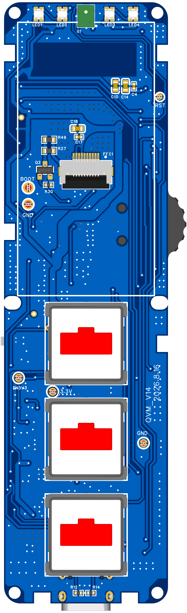
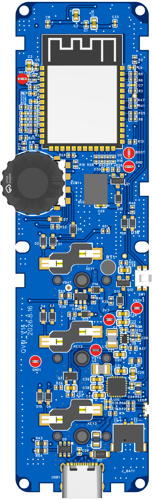

# MicStick V14 硬件与 GPIO

[返回开发入口](README.md)

## 硬件配置

| 模块 | 当前配置 | 固件接口 |
| --- | --- | --- |
| MCU | ESP32-S3-WROOM-1-N16R8，双核，最高 240 MHz | Arduino / ESP-IDF |
| 存储 | 16 MiB Flash、8 MiB OPI PSRAM | `qio_opi`；启用 `BOARD_HAS_PSRAM` |
| 显示 | 1.9 英寸、170×320、ST7789P3 兼容屏 | SPI，只写，当前 40 MHz、BGR、反色开启 |
| 主按键 | A/B/C，PCB 位号 KEY1/KEY2/KEY3 | 上拉输入，按下为 LOW |
| 旋钮 | ECD1，正交编码器及按压开关 D | A/B 两相及独立按压输入 |
| 侧键 | SW1，同时作用于 SGM41511 nQON 和 GPIO5 检测电路 | 上拉输入，按下为 LOW |
| 麦克风 | MSM261DHP006，位号 U1 | PDM，CLK/DATA，左声道 |
| RGB | 四颗串联，LED1～LED4；V14 BOM 型号 T65 | 3.3 V 供电，当前驱动 `NEO_GRB + NEO_KHZ800` |
| 蜂鸣器 | HYG-5030A，无源，经晶体管驱动 | LEDC PWM |
| 充电与电源路径 | SGM41511，位号 U10 | I²C 地址 `0x6B` |
| 电池测量 | EA6808、100kΩ/100kΩ 分压、1µF 电容 | GPIO7 ADC，读数乘 2 |
| 配套电池 | 单节 3.7 V、1000 mAh | 当前充电策略见下表；替换电池需重新核对规格 |
| USB-C | 供电与 ESP32-S3 原生 USB | GPIO19/20 |

麦克风的元件型号是 MSM261DHP006；网表中 `WMM7040...` 是封装名称。RGB 的封装标识为 `TX1812IJA-F01`；软件使用兼容的 NeoPixel 驱动参数，开发时按此接口操作。

## GPIO 表

方向均以 ESP32-S3 为参照。除显示引脚位于 [platformio.ini](../../QuickVibeMicStick/platformio.ini) 的 `micpad_pcb_common` 配置外，应用引脚定义来自 [pin_config.h](../../QuickVibeMicStick/pin_config.h) 的 `BOARD_MICSTICK_V14` 分支。

| 功能 | GPIO | 代码名称 | 电气或初始化要求 |
| --- | ---: | --- | --- |
| A 键 | 1 | `PIN_BUTTON` | `INPUT_PULLUP`，LOW=按下 |
| B 键 | 2 | `PIN_BUTTON_B` | `INPUT_PULLUP`，LOW=按下 |
| C 键 | 47 | `PIN_BUTTON_C` | `INPUT_PULLUP`，LOW=按下 |
| 旋钮 A 相 | 16 | `PIN_ENC_A` | 上拉，结合 B 相解码 |
| 旋钮 B 相 | 17 | `PIN_ENC_B` | 上拉；参考程序对方向取反 |
| 旋钮按压 D | 18 | `PIN_ENC_SW` | `INPUT_PULLUP`，LOW=按下 |
| 侧键 SW1 | 5 | `PIN_SIDE_BUTTON` | 输入，板上上拉；不要改成输出 |
| PDM 时钟 | 4 | `PIN_PDM_CLK` | 输出；当前 2.048 MHz |
| PDM 数据 | 6 | `PIN_PDM_DATA` | 输入；麦克风 L/R 接地 |
| LCD CS | 10 | `TFT_CS` | SPI 片选 |
| LCD MOSI | 11 | `TFT_MOSI` | SPI 数据输出，无 MISO |
| LCD SCLK | 12 | `TFT_SCLK` | SPI 时钟 |
| LCD D/C | 13 | `TFT_DC` | 命令/数据选择 |
| LCD RESET | 14 | `TFT_RST` | 低有效 |
| LCD 背光 | 21 | `PIN_LCD_BL_LOCAL` / `TFT_BL` | HIGH=亮；当前 PWM 5 kHz、8 bit、LEDC 通道 0 |
| RGB 数据 | 38 | `PIN_LED_DIN` | 四颗级联，GRB/800 kHz；关闭需发送全黑帧 |
| 蜂鸣器 | 39 | `PIN_BUZZER` | 当前 LEDC 通道 2；启动与停用时 LOW |
| 充电器 SDA | 8 | `PIN_CHARGER_SDA` | I²C，外部上拉 |
| 充电器 SCL | 40 | `PIN_CHARGER_SCL` | I²C，当前 100 kHz |
| 电池 ADC | 7 | `PIN_BAT_VOLT_LOCAL` | VBAT/2；上电等待至少 300 ms 后采样 |
| 整机 3.3 V 关断 | 9 | `PIN_PWR_KILL` | **LOW=保持供电，HIGH=断电** |
| USB D− | 19 | 原生 USB | 保留给 USB |
| USB D+ | 20 | 原生 USB | 保留给 USB |
| ROM 下载选择 | 0 | PCB `BOOT` 测试点 | 复位时拉低进入下载模式 |
| MCU 复位 | 非 GPIO | PCB `RST` 测试点，连接模块 EN | 拉低复位；与侧键 SW1 不同 |

GPIO8/40 已用于充电器；GPIO19/20 已用于 USB；N16R8 的 GPIO35/36/37 与 Octal PSRAM 相关，不作为应用扩展脚。GPIO0/3/45/46 涉及启动配置。GPIO41 仅保留测试/上拉网络。未列出的 GPIO 不代表存在可直接使用的外部接口，扩展前需核对接线与模块数据手册。

## 板上位置

以下为 V14 PCB 渲染图，可辨认 U1 麦克风、LED1～LED4、FPC1、KEY1～KEY3、ECD1、SW1、USB1，以及 BOOT/RST/GND 测试点。成品可能需要拆开外壳、移开屏幕才能接触测试点。图片用于定位，不能代替接线检查。

| 正面 | 背面 |
| --- | --- |
|  |  |

## 新固件必须保留的启动顺序

1. 在任何屏幕、串口或网络初始化之前，把 GPIO9 设置为输出 LOW。
2. 背光、蜂鸣器保持关闭；初始化 RGB 后发送全黑帧。拉低 RGB 数据脚不会清除灯珠已锁存的颜色。
3. 调用 `sgm41511_begin(PIN_CHARGER_SDA, PIN_CHARGER_SCL)`，检查返回值。
4. 初始化串口和应用外设。使用电池供电时不要通过 `while (!Serial)` 无限等待电脑。
5. 主循环持续调用 `sgm41511_tick()`，检查 `reachable`、`configured` 和故障状态。

可直接复用 [charger_sgm41511.h](../../QuickVibeMicStick/charger_sgm41511.h) / [.cpp](../../QuickVibeMicStick/charger_sgm41511.cpp)。驱动先停充电与 OTG，写入并读回限值，验证成功后启用充电，运行中约每秒检查配置。

| 充电器参数 | 当前程序设置 |
| --- | ---: |
| 输入限流 IINDPM | 800 mA |
| 快充电流 ICHG | 480 mA |
| 预充电流 / 终止电流 | 120 mA / 120 mA |
| 充电电压 VREG | 4.208 V |
| 系统最低电压 SYS_MIN | 3.5 V |
| 看门狗 / OTG | 关闭 / 关闭 |
| JEITA Cool 电流 | 20% ICHG |
| JEITA Warm 电压 | `JEITA_VSET=0`，上限约 4.1 V |

这些是软件设定值，不是本次实测值。更换电池时要核对允许充电电流、电压、温度和保护板。不要让未配置充电器的实验程序长期带电池接 USB 运行。

**NTC 的适用边界：** API 提供 Normal/Cool/Warm/Cold/Hot 等温区状态，不提供摄氏温度。当前硬件资料对 RT1 的 B 值及 R31 是否实装存在不一致，未经实装核对不能给这些状态标注精确温度，也不能据此修改保护阈值。保持驱动的 JEITA 设置即可开展普通应用开发。

## 电池、关机与恢复

GPIO7 读取的是电池分压。设置 12 bit ADC、11 dB 衰减，等 300 ms 稳定后调用 `analogReadMilliVolts()`，取多次采样中值再乘 2。电压推算百分比仅用于显示；SGM41511 没有可直接读取电池电压的 ADC 寄存器。

参考固件在电池供电且有效电压连续 5 次不高于 3300 mV 时关断 3.3 V。`VSYS_STAT` 表示电源调节状态，不能当成低电量标志。电池应用应复用 [power_manager.cpp](../../QuickVibeMicStick/power_manager.cpp) 及其策略，或实现等效的低电量和空闲管理。

GPIO9 HIGH 会让 MCU 断电；应先完成存储、停止采集、熄屏灭灯，再执行最后的关断动作。运输模式通过充电器 BATFET 控制，退出方式是插 USB 或按侧键唤醒充电器后再启动设备。普通输入事件不要直接调用运输模式提交操作。

## 外设参数速查

| 外设 | 当前有效配置 | 代码入口 |
| --- | --- | --- |
| LCD | TFT_eSPI；170×320、BGR、反色、40 MHz | `platformio.ini`、`ui_renderer.cpp` |
| PDM MIC | I²S0 Master/RX/PDM，16 kHz、16 bit、单声道；`DSR_16S`，2.048 MHz | `QuickVibeMicStick.ino` 的 `installI2S()` |
| 音频缓冲 | 512 samples/块，约 32 ms；预录目标约 400 ms | 同文件 `audioTask()` |
| 旋钮 | 双相状态机消抖；参考程序 `ENC_INVERT=1` | 同文件 `onEncChange()` |
| RGB | 4 灯、GRB、800 kHz | `led_manager.cpp` |
| 蜂鸣器 | 非阻塞音符播放，LEDC 通道 2 | `buzzer_fx.cpp` |
| 充电器 | `sgm41511_begin()` / `sgm41511_tick()` / `sgm41511_snapshot()` | `charger_sgm41511.*` |

PDM 接收的时钟引脚使用 Arduino 2.0.14 legacy I²S 驱动的 `ws_io_num` 字段；`bck_io_num` 为 `I2S_PIN_NO_CHANGE`。不要将麦克风当成普通三线 I²S 设备，也不要把 `DSR_16S` 随意改为 `DSR_8S`。

硬件型号依据 V14 原理图、BOM 和网表核对，接口参数依据当前源码核对。ESP32 下载模式参考：[Espressif Boot Mode Selection](https://docs.espressif.com/projects/esptool/en/latest/esp32s3/advanced-topics/boot-mode-selection.html)。
